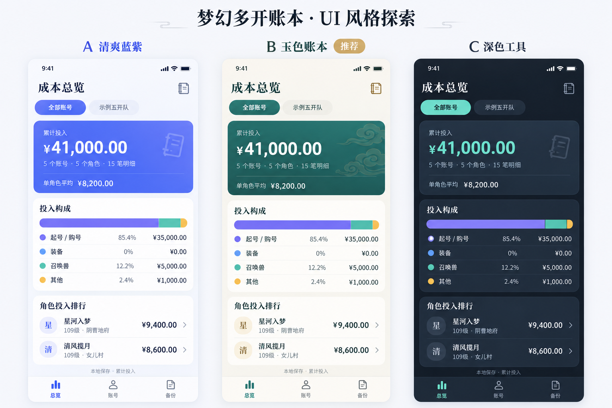
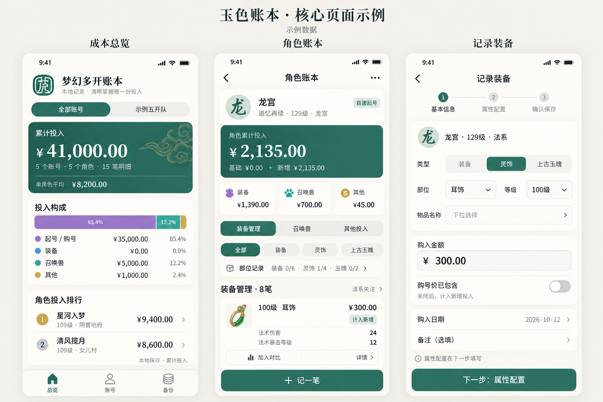

# UI 更新提案：玉色账本

本提案基于现有页面源码、项目截图和现有玉册图标。示例图使用演示数据；本次交付为设计探索，尚未修改应用页面。

后续进展：推荐方向已于 2026-10-12 落地为 v0.6.0，当前实现与真实截图见 [玉色账本 v0.6](ui-v0.6.md)。下方保留最初的设计探索记录。

## 设计判断

这是用于反复录入、核对金额和比较装备的本地工具。视觉应帮助玩家快速回答三个问题：这支队伍投入多少、这个角色花在哪里、这件装备有哪些关键属性。

目前已有总览、账号、角色、装备详情和备份的完整结构。主要问题在于角色页顶部内容过长，说明、开发导出、筛选和换算设置挤在资产列表之前；装备卡片的详情、对比、编辑、删除同时出现，操作层级不够明确；小标签和次要文案偏多。

## 三种方向

| 方向 | 表现 | 适用情况 | 取舍 |
| --- | --- | --- | --- |
| A 清爽蓝紫 | 冷白底、蓝紫强调、规整数据卡片 | 希望延续当前视觉、减少迁移工作 | 与其他工具较相似，游戏气质较弱 |
| B 玉色账本（推荐） | 暖白底、玉绿强调、少量金色和云纹 | 希望兼顾记账效率与梦幻玩家辨识度 | 需要统一替换颜色和组件样式 |
| C 深色工具 | 深灰蓝底、玉色点缀、较紧凑信息 | 经常夜间查看、偏好工具感 | 双主题增加维护工作，适合作为后续选项 |

建议采用 B：玉绿、暖白和少量金色能呼应已有玉册图标。云纹仅用于汇总卡片角落，正文、输入框和装备列表保持简洁。

## 页面调整

### 总览

- 用简短的“成本总览”替代占据首屏空间的宣传标题。
- 保留队伍筛选、累计投入、角色平均投入和角色排行。
- 汇总卡片只突出一个主金额，账号、角色、明细数量放在次级位置。
- 投入构成使用一条分段条与四行金额，缩短原来四组大间距进度条。零金额不绘制分段，但保留图例行。
- 保留“累计投入”口径；不把成本表述为市场估值、收益或净资产。
- 保留现有“总览 / 账号 / 备份”三项导航，增加统一线形图标。

### 账号

- 保留搜索，增加与总览一致的队伍筛选。
- 账号头部显示别名、队伍及投入总额，角色行显示门派、等级、服务器和角色投入。
- 编辑、删除放入账号菜单；添加角色是账号卡片的主要操作。
- 使用门派文字印记作为头像，无需依赖官方人物素材。

### 角色账本

- 角色身份、累计投入和三类成本摘要组成紧凑顶部。
- 直接进入“装备管理 / 召唤兽 / 其他投入”分类。
- 部位记录缩成可展开的一行；展开才显示尚未记录的具体部位。它只代表账本录入覆盖情况，不能暗示角色实际上没有装备。
- 流派关注保留轻量切换入口，种族和换算参数收进角色设置。
- 装备卡片突出名称、金额、计价标记和最多三项关键属性。
- 点卡片打开详情，保留“加入对比”次要按钮；编辑、删除进入详情菜单。
- “记一笔”固定在页面底部，为列表预留底部空间。
- JSON 导出移入菜单；起号规则解释按需展开。错误和影响计价的提示仍须直接显示。

### 记录装备

建议把现有长表单改为三段：基本信息、属性配置、确认保存。这属于拟议交互调整，尚未实现。

- 基本信息：类型、部位、等级、物品、购入金额、计价标记、日期。
- 属性配置：按类型展示基础属性、附加属性、宝石和特殊配置，仍使用搜索选择器。
- 确认保存：展示自动生成名称、录入属性和计入累计投入的金额。
- “购号价已包含”需紧邻金额，明确开关对统计的影响。
- 分步切换保留草稿；离开未保存表单提示保留或放弃；校验失败定位到对应步骤。
- 自建起号、裸号购入和整号购入的现有业务规则继续保留。

### 装备详情与对比

- 详情按“关键属性 / 完整配置 / 成本与来源”分组。
- 对比继续限定同一部位、最多两件；明确展示金额差与各项属性差。
- 属性估算须保留估算标识，计算口径放在可展开说明里。
- 随号资产参考价保留标签和说明，避免与新增投入混淆。

## 推荐视觉规范

| 项目 | 建议 |
| --- | --- |
| 页面底色 | `#F5F4EE` |
| 卡片底色 | `#FFFEFB` |
| 主色 | `#287565` |
| 正文颜色 | `#203A33` |
| 次要文字 | `#78847D`，落地时根据背景检查可读性 |
| 选中底色 | `#E7F0EA` |
| 装饰金色 | `#C6A46B`，不承担小字信息 |
| 分类色 | 起号紫、装备蓝、召唤兽青绿、其他琥珀，跨页面一致 |
| 字体 | 正文使用系统中文无衬线；金额采用等宽数字；标题可少量使用宋体 |
| 字号 | 主金额 32–36px，页面标题 22–24px，正文 15–16px，辅助信息 12–13px |
| 间距 | 4 / 8 / 12 / 16 / 24px；页面左右 16–20px |
| 圆角 | 卡片 12–16px；标签 6–8px |
| 操作区域 | 至少 44px 高；固定按钮适配底部安全区 |

示例图展示的是视觉方向，生产页面需校验真实字体、长名称、大金额、空状态、错误状态、键盘弹出与小屏滚动。

## 落地顺序

1. 先统一全局颜色、字体、间距和导航，再完成总览与账号页面。
2. 重排角色页，精简装备卡片和部位记录，调整操作入口。
3. 改造录入表单，再统一详情、对比和备份页面。

项目采用 uni-app x 蒸汽模式，应以现有简单类选择器、原生组件和本地静态图标实现；不依赖复杂 CSS 滤镜、毛玻璃或重动画。实现后检查 Web 与 Android 原生显示，验证计价、保存、筛选和备份流程仍正确。

## 示例图与生成说明

图一比较三种方向，图二展示推荐方向的总览、角色与装备录入页面。图片通过内置 imagegen 生成，属于设计参考，不是运行截图。完整生成提示词保存于同目录 `ui-redesign-prompts.md`。

